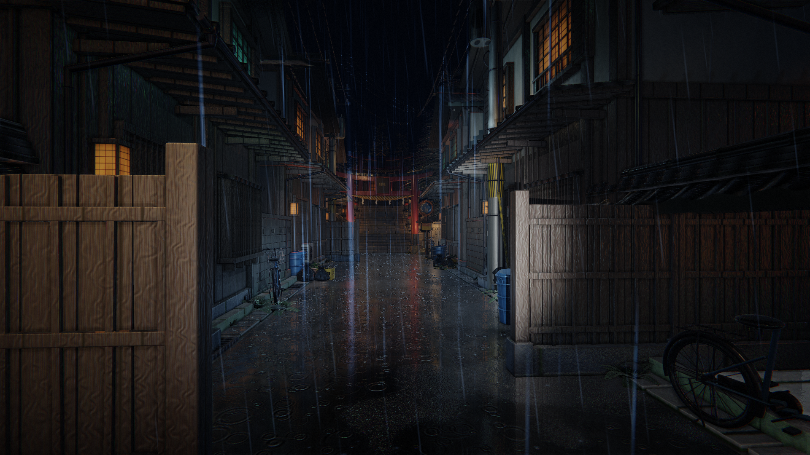

# Yugiri Village · 유우기리 마을 (夕霧村)

밤의 골목에서 언덕 위 신사로 향하는 Unity 3D 탐험 게임입니다. 프로젝트 소스, 모델·텍스처·사운드, Blender 원본과 에셋 제작 스크립트를 함께 보관합니다.



## 실행

### 브라우저에서 플레이

[yugiri-village.vercel.app](https://yugiri-village.vercel.app/)

주소에 접속하면 Unity Web 게임을 곧바로 불러옵니다. 키보드와 마우스로 플레이합니다. 첫 방문에는 게임 파일 다운로드가 필요합니다.

### Unity 에디터

1. **Unity 6000.3.19f1**을 설치합니다.
2. Unity Hub에서 저장소 안의 `YugiriVillage` 폴더를 프로젝트로 추가합니다.
3. `Assets/Scenes/YugiriVillage.unity` 씬을 열고 **Play**를 누릅니다.

## 조작

| 조작 | 기능 |
|---|---|
| WASD | 이동 |
| 마우스 | 시점 회전 |
| 왼쪽 Shift | 달리기 |
| 마우스 오른쪽 버튼 | 확대 관찰 |
| F | 손전등 켜기·끄기 |
| E | 조사·상호작용 |
| Esc | 마우스 잠금 전환 |

## 구성

- `YugiriVillage/Assets`: 씬, 게임 코드, 셰이더, 모델, 재질, 텍스처, 사운드와 Unity 메타데이터
- `YugiriVillage/Packages`, `YugiriVillage/ProjectSettings`: 패키지 의존성과 프로젝트 설정
- `YugiriVillage/YugiriVillage_MasterAssets.blend`: Blender 제작 원본
- `tools`: 모델·PBR 텍스처·사운드 제작 스크립트와 로컬 제작 도구 연결 스크립트
- `Screenshots`: 플레이 장면과 에셋 미리보기

Unity의 `Library`, `Temp`, `Logs`, `UserSettings` 폴더는 프로젝트를 열 때 생성됩니다.

## 웹 배포

`web/`에 브라우저 실행 페이지와 미리 빌드한 Unity Web 파일이 있습니다. `vercel.json`은 이 폴더를 출력 경로로 지정하고 gzip 압축된 WebAssembly·JavaScript·게임 데이터에 필요한 응답 헤더를 설정합니다. Vercel에서는 배포할 파일을 검증한 뒤 이 결과물을 제공합니다.

웹 빌드를 다시 만들려면 Unity **6000.3.19f1**의 **WebGL Build Support** 모듈이 필요합니다.

```powershell
powershell -ExecutionPolicy Bypass -File tools/build-web.ps1
node tools/verify-web-build.mjs
```

빌드 스크립트는 `.web-build-work/`에 프로젝트 복사본을 만들고 CPU 코어 2개로 제한하여 빌드합니다. Unity 설치 경로가 다르면 `-UnityPath` 인자로 지정할 수 있습니다. 열린 원본 프로젝트의 플랫폼 설정을 변경하지 않습니다.

웹 빌드 결과와 설정을 GitHub에 푸시하면 연결된 Vercel 프로젝트에서 자동 배포됩니다. Vercel 프로젝트의 Root Directory는 저장소 루트로 설정합니다.

웹의 기존 한글·일본어 안내 표시는 Noto Sans CJK에서 게임에 쓰인 글자를 추린 폰트를 사용합니다. 원본은 [Noto CJK](https://github.com/notofonts/noto-cjk)이고, 재배포 라이선스는 `tools/web-font/LICENSE.txt`와 `web/font-license.txt`에 포함했습니다.
